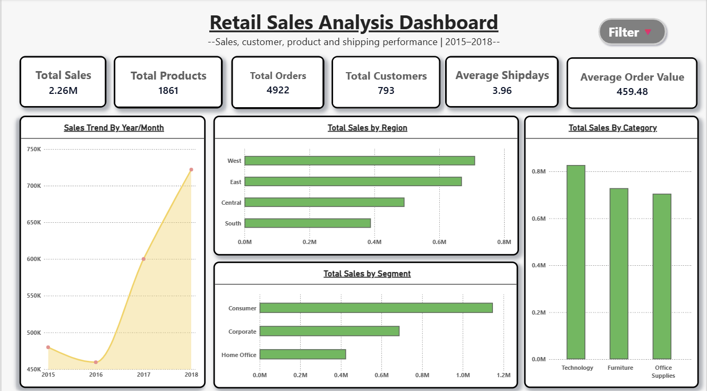
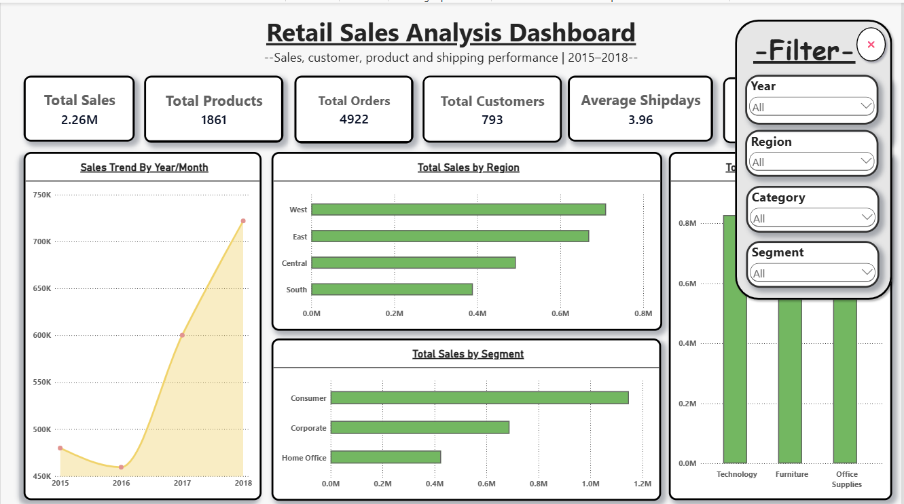
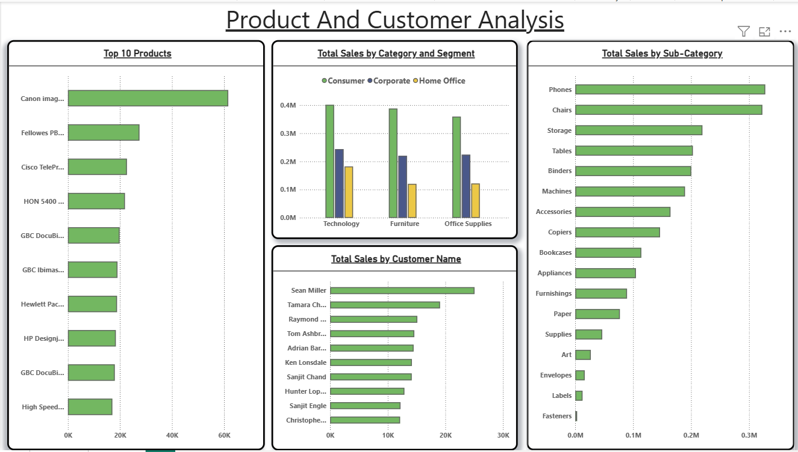

# Retail Sales Analysis | Python, SQL & Power BI

A complete end-to-end retail sales analysis project built to understand sales performance across **time, region, category, customers, products, segments, and shipping**.

The project combines **Python EDA, SQL analysis, and an interactive Power BI dashboard** into one workflow.

---

## Project at a Glance

| Area | Details |
|---|---|
| Analysis period | 2015–2018 |
| Records | 9,800 |
| Unique Orders | 4,922 |
| Unique Customers | 793 |
| Unique Products | 1,861 |
| Total Sales | $2.26M |
| Average Order Value | $459.48 |
| Average Ship Days | 3.96 days |
| Categories | Technology, Furniture, Office Supplies |
| Regions | West, East, Central, South |
| Segments | Consumer, Corporate, Home Office |
| Ship Modes | Standard Class, Second Class, First Class, Same Day |

> **Important:** The dataset contains **Sales** but does not contain a Profit column. Therefore, this project focuses on sales, customer, product, regional, time, and shipping analysis rather than profitability.

---

## Dashboard Preview

### Executive Overview



<details>
<summary><strong>What can be explored on this page?</strong></summary>

- Total Sales
- Total Products
- Total Orders
- Total Customers
- Average Ship Days
- Average Order Value
- Year/Month sales trend
- Regional sales
- Segment sales
- Category sales
- Interactive filters for Year, Region, Category, and Segment

The filter button opens a collapsible filter panel. The same filters are synchronized across the dashboard pages.
</details>

---

### Executive Overview with Filters



The dashboard uses a collapsible filter panel to keep the main report area clean while still allowing interactive analysis.

**Available filters:**

`Year` → `Region` → `Category` → `Segment`

---

### Product & Customer Analysis



<details>
<summary><strong>What can be explored on this page?</strong></summary>

- Top 10 products by sales
- Top 10 customers by sales
- Sales by category and customer segment
- Sales by sub-category
- Product concentration
- Customer concentration
- Category-level customer behavior

This page helps move from overall business performance into product and customer-level analysis.
</details>

---

### Regional & Shipping Analysis


<details>
<summary><strong>What can be explored on this page?</strong></summary>

- Top states by sales
- Sales by shipping mode
- Average shipping days by shipping mode
- Regional sales by category
- Regional category contribution
- Shipping performance across regions

This page focuses on geographic distribution and delivery behavior.
</details>

---

# 1. Business Questions

The project was built around practical questions that a data analyst may receive from a business team.

### Sales
- What are the total sales and average order value?
- How do sales change over time?
- Which categories generate the most sales?
- Which regions and states generate the most sales?
- Which sub-categories contribute the most?

### Customers
- Which customer segments generate the most sales?
- Which customers have the highest sales?
- How concentrated are sales among the top customers?

### Products
- Which products generate the highest sales?
- What are the top products within each category?
- How concentrated are sales among the top products?
- Which products perform strongly across different regions?

### Shipping
- Which shipping modes are used most?
- What is the average shipping time for each shipping mode?
- How does shipping time vary by region?

---

# 2. Project Workflow

The analysis followed an end-to-end data analyst workflow:

```text
Raw Retail Dataset
        |
        v
Data Loading
        |
        v
Data Cleaning & Date Preparation
        |
        v
Python Exploratory Data Analysis
        |
        +---- KPI Analysis
        +---- Time Analysis
        +---- Category Analysis
        +---- Segment Analysis
        +---- Customer Analysis
        +---- Product Analysis
        +---- Geographic Analysis
        +---- Shipping Analysis
        |
        v
SQL Analysis
        |
        +---- Aggregations
        +---- Subqueries
        +---- CTEs
        +---- CASE
        +---- Window Functions
        +---- Ranking
        +---- YoY Growth
        +---- MoM Growth
        +---- Running Totals
        +---- Moving Averages
        +---- JOINs
        |
        v
Power BI Data Model & Measures
        |
        v
Interactive Dashboard
        |
        v
Final Report & Portfolio Project
```

---

# 3. Tools Used

### Python

- Pandas
- NumPy
- Matplotlib
- Seaborn
- Jupyter Notebook

Used for:

- Data loading
- Data cleaning
- Date transformation
- KPI calculations
- GroupBy analysis
- Pivot tables
- Crosstab
- Ranking
- Percentage calculations
- Exploratory visualization

### SQL / MySQL

Used for:

- Aggregation
- Filtering
- GROUP BY / HAVING
- Subqueries
- CTEs
- CASE statements
- Window functions
- Ranking
- Time-series analysis
- JOINs
- Running totals
- Moving averages
- YoY and MoM analysis

### SQL Connection

The project also includes a Python-to-SQL workflow using:

- SQLAlchemy
- PyMySQL
- Pandas `read_sql_query()`

This allows analysis to move between Python and a MySQL database.

### Power BI

Used for:

- KPI cards
- Interactive charts
- Slicers
- Drill-down
- Dashboard design
- Cross-page filtering
- Bookmarks
- Collapsible filter panel
- Business presentation

---

# 4. Dataset Overview

The dataset contains retail transaction-level records with information about:

```text
Order
 ├── Order ID
 ├── Order Date
 └── Ship Date

Customer
 ├── Customer ID
 ├── Customer Name
 └── Segment

Location
 ├── Country
 ├── City
 ├── State
 ├── Postal Code
 └── Region

Product
 ├── Product ID
 ├── Category
 ├── Sub-Category
 └── Product Name

Sales
 └── Sales
```

### Main analytical columns

`Order Date`, `Ship Date`, `Ship Mode`, `Customer ID`, `Customer Name`, `Segment`, `State`, `Region`, `Product ID`, `Category`, `Sub-Category`, `Product Name`, and `Sales`.

---

# 5. Data Preparation

The Python notebook performs the main preparation steps before analysis.

### Date conversion

Order Date and Ship Date were converted into proper datetime values.

Additional time fields were created:

- Year
- Month
- Month Name
- Year Month

### Shipping duration

Shipping time was calculated as:

```text
Ship Days = Ship Date - Order Date
```

This created the basis for shipping analysis in both Python and Power BI.

### Data quality

The final dataset contains:

- 9,800 rows
- 24 columns in the final prepared dataset
- No duplicate rows
- 11 missing Postal Code values

The missing Postal Code values were retained because they do not prevent the sales analysis and removing those rows would unnecessarily remove valid transactions.

---

# 6. Key KPIs

The main KPIs calculated in Python, SQL, and Power BI are:

| KPI | Value |
|---|---:|
| Total Sales | $2,261,536.78 |
| Total Orders | 4,922 |
| Total Customers | 793 |
| Total Products | 1,861 |
| Average Order Value | $459.48 |
| Average Ship Days | 3.96 |
| Sales per Customer | $2,851.87 |
| Orders per Customer | 6.21 |

### KPI formulas

```text
Total Sales
= SUM(Sales)

Total Orders
= DISTINCT COUNT(Order ID)

Total Customers
= DISTINCT COUNT(Customer ID)

Total Products
= DISTINCT COUNT(Product ID)

Average Order Value
= Total Sales / Total Orders

Sales per Customer
= Total Sales / Total Customers

Orders per Customer
= Total Orders / Total Customers
```

---

# 7. Main Findings

## 7.1 Sales by Year

| Year | Sales | YoY Growth |
|---|---:|---:|
| 2015 | $479,856.21 | — |
| 2016 | $459,436.01 | -4.26% |
| 2017 | $600,192.55 | 30.64% |
| 2018 | $722,052.02 | 20.30% |

The analysis shows a decrease from 2015 to 2016 followed by substantial year-over-year sales growth in 2017 and 2018.

---

## 7.2 Sales by Category

| Category | Share of Sales |
|---|---:|
| Technology | 36.59% |
| Furniture | 32.22% |
| Office Supplies | 31.19% |

Technology represents the largest share of total sales in the analyzed dataset.

---

## 7.3 Sales by Region

The four regions are:

- West
- East
- Central
- South

The dashboard shows the West and East regions contributing larger total sales than Central and South.

Regional category analysis was also performed to understand how category contribution changes across regions.

---

## 7.4 Sales by Segment

The project analyzes:

- Consumer
- Corporate
- Home Office

Consumer is the largest segment by sales in the dataset.

The Python analysis also calculated each segment's category mix.

---

## 7.5 State-Level Analysis

The top states by total sales include:

| State | Sales | Share of Total Sales |
|---|---:|---:|
| California | $446,306.46 | 19.73% |
| New York | $306,361.15 | 13.55% |
| Texas | $168,572.53 | 7.45% |
| Washington | $135,206.85 | 5.98% |
| Pennsylvania | $116,276.65 | 5.14% |
| Florida | $88,436.53 | 3.91% |

The state analysis was also extended into category-level comparisons.

---

## 7.6 Sub-Category Analysis

The leading sub-categories by sales include:

1. Phones
2. Chairs
3. Storage
4. Tables
5. Binders
6. Machines
7. Accessories
8. Copiers

The analysis also examined category/sub-category combinations instead of looking only at overall category totals.

---

## 7.7 Customer Concentration

The top 10 customers were calculated based on total sales.

Their combined contribution is approximately:

```text
6.80% of total sales
```

This provides a simple measure of how much of the total sales value comes from the highest-value customer group.

---

## 7.8 Product Concentration

The top 10 products were also analyzed.

Their combined contribution is approximately:

```text
10.82% of total sales
```

The project additionally identifies the top 3 products within each category.

---

## 7.9 Shipping Analysis

Average shipping time:

```text
Overall average = 3.96 days
```

The Power BI dashboard compares average shipping days across:

- Standard Class
- Second Class
- First Class
- Same Day

The project also compares shipping time across regions.

Example from the Python regional shipping analysis:

| Region | First Class | Same Day | Second Class | Standard Class |
|---|---:|---:|---:|---:|
| Central | 2.31 | 0.03 | 3.36 | 4.98 |
| East | 2.21 | 0.00 | 3.27 | 4.97 |
| South | 2.12 | 0.01 | 3.20 | 5.01 |
| West | 2.10 | 0.10 | 3.17 | 5.07 |

---

# 8. Python Analysis

The Python notebook covers the analysis from raw data to business insights.

### Main Pandas techniques used

```python
groupby()
pivot_table()
crosstab()
sort_values()
reset_index()
rank()
idxmax()
max()
div()
mul()
melt()
stack()
```

### Main analysis areas

```text
KPI Analysis
     ↓
Time Analysis
     ↓
Category / Sub-Category
     ↓
Region
     ↓
Segment
     ↓
Customer
     ↓
Product
     ↓
State / City
     ↓
Shipping
```

### Visualizations created

- Bar charts
- Horizontal bar charts
- Line charts
- Pie chart
- Histogram
- Box plot
- Heatmap
- Stacked bar chart

---

# 9. SQL Analysis

The SQL work goes beyond basic aggregation.

### Basic SQL

- SELECT
- WHERE
- DISTINCT
- GROUP BY
- HAVING
- ORDER BY
- LIMIT

### Aggregation

- SUM
- AVG
- COUNT
- MIN
- MAX

### Data transformation

- CASE
- LOWER
- CONCAT
- LENGTH
- DATE functions
- DATEDIFF

### Advanced SQL

- Subqueries
- CTEs
- Temporary tables
- Views
- Window functions
- Ranking
- LAG
- LEAD
- Running totals
- Moving averages
- YoY growth
- MoM growth

### JOIN analysis

The project also demonstrates:

```text
INNER JOIN
LEFT JOIN
CROSS JOIN
SELF JOIN
```

The final SQL file is organized as a complete analysis flow rather than as disconnected practice queries.

---

# 10. Power BI Dashboard

The final Power BI dashboard contains three main pages.

## Page 1 — Executive Overview

### KPI cards

- Total Sales
- Total Products
- Total Orders
- Total Customers
- Average Ship Days
- Average Order Value

### Charts

- Sales Trend by Year/Month
- Total Sales by Region
- Total Sales by Segment
- Total Sales by Category

### Interactive controls

- Year
- Region
- Category
- Segment

---

## Page 2 — Product & Customer Analysis

### Charts

- Top 10 Products
- Top 10 Customers
- Sales by Category and Segment
- Sales by Sub-Category

This page is designed to answer:

> Which products and customers are contributing most to sales?

---

## Page 3 — Regional & Shipping Analysis

### Charts

- Total Sales by State
- Total Sales by Ship Mode
- Average Ship Days by Ship Mode
- Total Sales by Region and Category

This page is designed to answer:

> Where are sales coming from and how does shipping performance vary?

---

# 11. Interactive Filter Panel

The dashboard uses a collapsible filter panel.

```text
             FILTER
                |
        +-------+-------+
        |               |
       Year           Region
        |               |
     Category         Segment
```

The filter panel is controlled using Power BI bookmarks.

The slicers are synchronized across all three report pages, allowing the same selections to affect the dashboard consistently.

For example:

```text
Select:
Year = 2018
Region = West
Category = Technology

                ↓

All dashboard pages update
                ↓

Executive
Product & Customer
Regional & Shipping
```

---

# 12. Power BI Measures

The dashboard uses measures such as:

```DAX
Total Sales =
SUM(Retail[Sales])
```

```DAX
Total Orders =
DISTINCTCOUNT(Retail[Order ID])
```

```DAX
Total Customers =
DISTINCTCOUNT(Retail[Customer ID])
```

```DAX
Total Products =
DISTINCTCOUNT(Retail[Product ID])
```

```DAX
Average Order Value =
DIVIDE([Total Sales], [Total Orders])
```

```DAX
Average Ship Days =
AVERAGE(Retail[Ship Days])
```

These measures allow the dashboard to respond dynamically to slicers and other report interactions.

---

# 13. Project Structure

Recommended GitHub structure:

```text
Retail-Sales-Analysis/
│
├── README.md
│
├── data/
│   └── retail.csv
│
├── notebooks/
│   ├── Retail_project-python.ipynb
│   └── Sql_connect.ipynb
│
├── sql/
│   └── retail_sales_analysis_final.sql
│
├── powerbi/
│   └── Retail_Sales_Analysis_Dashboard.pbix
│
├── images/
│   ├── dashboard_1.png
│   ├── dashboard_1.1.png
│   ├── dashboard_2.png
│   └── dasboard_3.png
│
└── report/
    └── Retail_Sales_Analysis_Report.pdf
```

> If the original dataset is not licensed for redistribution, do not upload the raw CSV. Instead, document the source and provide instructions for obtaining it.

---

# 14. How to Run the Project

## Step 1 — Python

Open:

```text
notebooks/Retail_project-python.ipynb
```

Install the required libraries:

```bash
pip install pandas numpy matplotlib seaborn jupyter
```

Run the notebook from top to bottom.

---

## Step 2 — MySQL

Create the database and retail table.

Then run:

```text
sql/retail_sales_analysis_final.sql
```

The SQL file is organized in the order:

```text
Database Check
      ↓
Data Quality
      ↓
KPIs
      ↓
Category
      ↓
Region
      ↓
Segment
      ↓
Customer
      ↓
Product
      ↓
Time
      ↓
Shipping
      ↓
Advanced SQL
      ↓
JOIN Analysis
      ↓
Final Validation
```

---

## Step 3 — Python to SQL Connection

Open:

```text
notebooks/Sql_connect.ipynb
```

The notebook demonstrates connecting Python to MySQL using SQLAlchemy and PyMySQL and retrieving SQL results into Pandas.

---

## Step 4 — Power BI

Open:

```text
powerbi/Retail_Sales_Analysis_Dashboard.pbix
```

Refresh the data if required.

The dashboard contains:

- KPI cards
- Charts
- Slicers
- Cross-page filtering
- Drill-down
- Bookmarks
- Collapsible filter panel

---

# 15. Important Analytical Limitation

The dataset does not contain:

```text
Profit
Profit Margin
Cost
Discount
Returns
```

Therefore, the project does **not** make profitability claims.

The analysis is intentionally focused on:

```text
Sales
Orders
Customers
Products
Segments
Categories
Regions
States
Time
Shipping
```

This distinction is important when interpreting the dashboard.

---

# 16. Skills Demonstrated

This project demonstrates practical knowledge of:

### Data Analysis

- Data cleaning
- Exploratory data analysis
- KPI development
- Aggregation
- Segmentation
- Time-series analysis
- Customer analysis
- Product analysis
- Geographic analysis
- Shipping analysis

### Python

- Pandas
- NumPy
- Matplotlib
- Seaborn
- Jupyter

### SQL

- MySQL
- Aggregations
- CTEs
- Subqueries
- CASE
- Window functions
- Ranking
- LAG / LEAD
- JOINs
- Time-series calculations

### Power BI

- Data modeling
- DAX measures
- Interactive visuals
- Slicers
- Drill-down
- Bookmarks
- Cross-page filtering
- Dashboard design

### Analytics Thinking

- Translating business questions into analytical queries
- Selecting suitable visualizations
- Comparing dimensions
- Finding concentration patterns
- Converting analysis into dashboard-ready insights

---

# 17. Final Outcome

The final project connects three stages of data analysis:

```text
                 DATA
                  |
        +---------+---------+
        |                   |
      Python                SQL
        |                   |
        +---------+---------+
                  |
             ANALYSIS
                  |
                  v
              POWER BI
                  |
                  v
          BUSINESS DASHBOARD
                  |
                  v
             INSIGHTS
```

Instead of using only one tool, the project demonstrates a complete workflow from **raw transactional data → analysis → SQL querying → visualization → interactive business dashboard**.

---

## Dashboard Navigation

| Page | Main Purpose |
|---|---|
| Executive Overview | Overall sales and business KPIs |
| Product & Customer Analysis | Product, customer and sub-category performance |
| Regional & Shipping Analysis | Geographic and shipping performance |

---

## Project Deliverables

- Python EDA notebook
- Python-to-MySQL connection notebook
- Final MySQL analysis script
- Power BI dashboard
- Dashboard screenshots
- Project report
- GitHub documentation

---

## Final Note

This project was created as a practical data analytics portfolio project to demonstrate the complete process of taking a retail dataset and turning it into structured analysis and an interactive dashboard.

**Core workflow:**

`Python → SQL → Power BI → Insights → Report`

